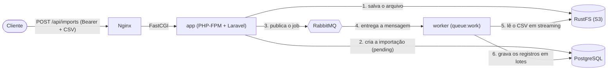
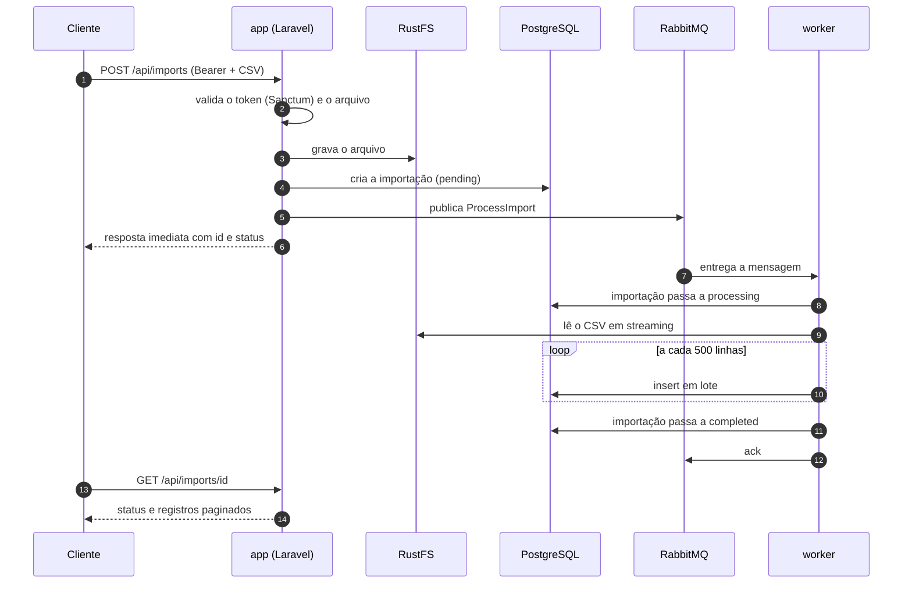
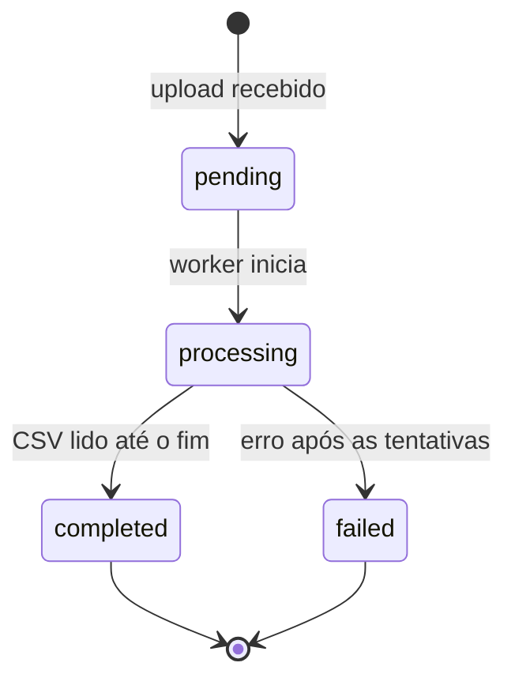
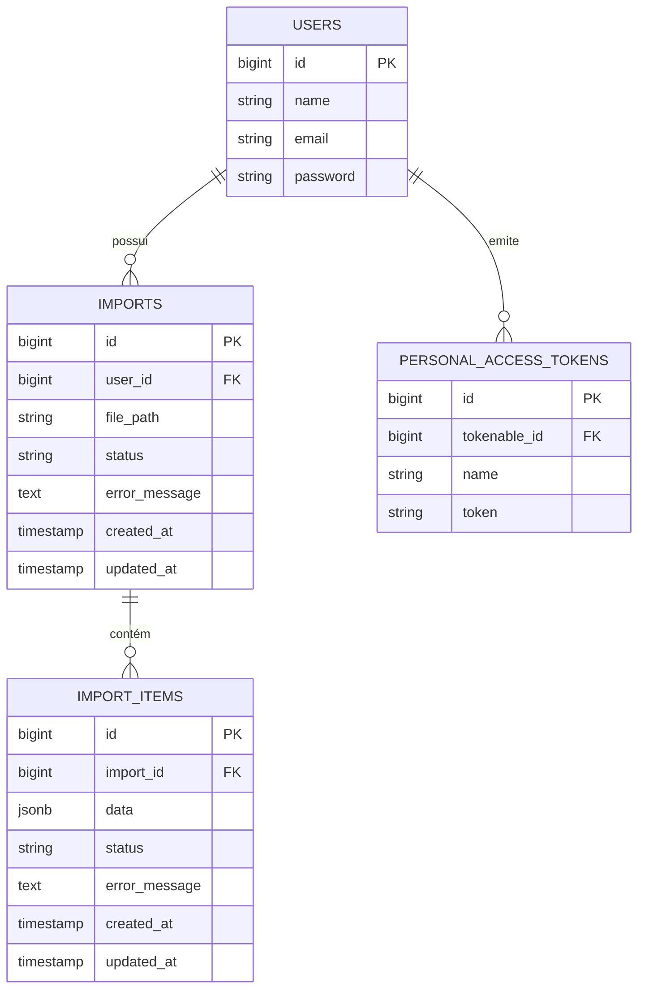

# Dataflow

**API de processamento assíncrono de arquivos CSV.** O cliente envia um arquivo autenticado, recebe uma resposta imediata e acompanha o processamento pelo status, enquanto um worker lê o arquivo em segundo plano e grava cada linha como JSON no PostgreSQL.


## Sumário

- [Visão geral](#visão-geral)
- [Arquitetura](#arquitetura)
- [Decisões de arquitetura](#decisões-de-arquitetura)
- [Escalabilidade](#escalabilidade)
- [Modelo de dados](#modelo-de-dados)
- [API](#api)
- [Stack e serviços](#stack-e-serviços)
- [Estrutura do projeto](#estrutura-do-projeto)
- [Como executar](#como-executar)
- [Configuração](#configuração)
- [Operação e depuração](#operação-e-depuração)
- [Testes](#testes)
- [Limitações e dívida técnica](#limitações-e-dívida-técnica)
- [Roadmap](#roadmap)
- [Solução de problemas](#solução-de-problemas)
- [Licença](#licença)

---

## Visão geral

### O problema

Processar um CSV grande dentro da própria requisição HTTP não funciona bem: o cliente espera por minutos, a requisição estoura o tempo limite, o processo PHP consome memória lendo o arquivo inteiro, e um pico de uploads derruba a API.

### A solução

A API **recebe, guarda e delega**. O processamento pesado acontece fora do ciclo da requisição:

1. O cliente se autentica e envia o CSV para a API.
2. O arquivo é salvo no bucket S3 e uma importação é registrada no PostgreSQL.
3. Um job é publicado no RabbitMQ e consumido pelo serviço `worker`.
4. O worker lê o arquivo em fluxo (*streaming*), interpreta as linhas e salva os registros em lotes.
5. O cliente consulta o estado da importação e seus registros pela API.

### O que o projeto demonstra

- Processamento assíncrono com um *message broker* (RabbitMQ), com retentativas, confirmação (ack) e tratamento de falha.
- Armazenamento de objetos compatível com S3, compartilhado entre containers.
- Leitura de arquivos grandes em *streaming*, com memória constante, e inserção em lotes.
- Processamento **idempotente**, necessário porque a entrega da fila é "pelo menos uma vez".
- Autenticação por token pessoal com Laravel Sanctum.
- Separação de responsabilidades (Controller, Request, Service, Job, Resource).
- Ambiente reproduzível com Docker Compose, com *healthchecks* e ordem de inicialização.

---

## Arquitetura

### Componentes



### Fluxo de uma importação



### Responsabilidade de cada componente

| Componente | Responsabilidade | O que **não** faz |
|---|---|---|
| **Nginx** | Porta de entrada HTTP, limite de upload, repasse ao PHP-FPM | Não executa PHP |
| **PHP-FPM (`app`)** | Autentica, valida, grava o arquivo, cria a importação e publica o job | Não processa o CSV |
| **RabbitMQ** | Guarda as mensagens até um worker confirmar o processamento | Não guarda o estado da importação |
| **Worker (`queue:work`)** | Consome a fila e executa o `ProcessImport` | Não recebe HTTP |
| **RustFS** | Armazena os arquivos enviados (API S3) | Não conhece o conteúdo |
| **PostgreSQL** | Fonte da verdade: usuários, importações, registros e status | Não guarda arquivos |

O RabbitMQ guarda a mensagem só até ela ser consumida, e depois ela some. O **estado** da importação vive no banco, e a mensagem é apenas um ponteiro ("processe a importação 7").

### Camadas no código

```
HTTP        Controller  →  Request (validação)  →  Service (regra de criação)  →  dispatch
Fila        Job (a mensagem, tentativas, timeout)  →  Service de processamento (regra de leitura do CSV)
Resposta    Resource (contrato público do JSON)
```

- O **serviço de importação** (`ImportService`) é o *producer*: salva o arquivo, cria o registro e publica o job.
- O **`ProcessImport`** é a mensagem e a ponte para o processamento. Só sabe de fila (tentativas e timeout).
- O **serviço de processamento do CSV** contém a regra de negócio da leitura. Como não conhece HTTP nem fila, é testável isoladamente.

### Ciclo de vida da importação



Uma importação termina `completed` mesmo que algumas linhas sejam inválidas: essas linhas são gravadas como `{"raw": [...]}` e marcadas com falha, e o processamento segue. A importação só termina `failed` quando o arquivo inteiro não pôde ser processado.

### Garantias e comportamento em falhas

| Situação | Comportamento |
|---|---|
| Requisição sem token válido | `401` |
| Arquivo ausente, de tipo inválido ou acima do limite | `422` (ou `413`, se passar do limite do Nginx) |
| Worker cai no meio do processamento | A mensagem não foi confirmada, então volta à fila e é reprocessada |
| O job lança exceção | O Laravel tenta de novo, até 3 vezes |
| Tentativas esgotadas | A importação é marcada como `failed`, e o job vai para `failed_jobs` |
| Linha com número de colunas diferente do cabeçalho | Gravada como `{"raw": [...]}` com falha, e o processamento continua |
| Job passa de 5 minutos | O worker o encerra e conta como falha da tentativa |

**Entrega "pelo menos uma vez".** O mesmo job pode rodar mais de uma vez (retentativa, worker reiniciado). Por isso o processamento precisa ser **idempotente**: ao começar, ele apaga os registros já gravados da importação, e reprocessar não duplica dados.

---

## Decisões de arquitetura

| Decisão | Motivo | Trade-off |
|---|---|---|
| **Processar em segundo plano** e responder logo | O upload não bloqueia, e a API mantém tempo de resposta baixo mesmo com arquivos grandes | O cliente precisa consultar o status (*polling*) |
| **RabbitMQ** como fila, em vez da tabela `jobs` ou Redis | Confirmação por mensagem (ack), reentrega automática se o worker morrer, desacoplamento do banco | Mais um serviço para operar, e instância única (sem alta disponibilidade) |
| Arquivos em **armazenamento S3** (RustFS), não no disco | `app` e `worker` rodam em containers diferentes e precisam enxergar o mesmo arquivo. O S3 também escala melhor que um volume local | Dependência de rede, e um serviço a mais |
| **RustFS** em vez de MinIO | As imagens oficiais do MinIO deixaram de estar disponíveis no Docker Hub | O RustFS é um projeto mais jovem |
| Leitura em **streaming** | Memória praticamente constante, independente do tamanho do arquivo | Código mais imperativo que carregar tudo numa coleção |
| **Insert em lotes de até 500** | Um insert por 500 linhas é muito mais rápido que um por linha, e fica abaixo do limite de parâmetros do PostgreSQL | O `insert()` em lote ignora o Eloquent: casts, enums e timestamps são feitos à mão |
| Linha em **JSON** | CSVs diferentes têm colunas diferentes, e o JSON evita uma tabela por layout. É consultável com `data->>'campo'` | Sem tipagem nem restrições por coluna |
| Linhas inválidas **não abortam** a importação | Uma linha ruim não pode derrubar milhões de linhas boas | O consumidor precisa tratar os registros com falha |
| **Job fino + Service** | O job só conhece a fila, e a regra de negócio fica testável sem RabbitMQ | Uma classe a mais |
| **Enums do PHP** com `cast` no Model | Valores de status válidos em um lugar só, com autocomplete e erro imediato em caso de typo | A coluna continua `string`, então o banco não recusa valores fora do enum |
| **Sanctum** (tokens pessoais) | Autenticação simples e suficiente para uma API consumida por clientes próprios | Tokens não expiram por padrão, e não há *refresh* |
| **Nginx + PHP-FPM** em containers separados | Padrão de mercado: o Nginx serve estáticos e repassa o dinâmico | Dois containers para um papel |
| **Healthchecks** + `depends_on: service_healthy` | Os serviços sobem na ordem certa, só depois de o banco e a fila estarem prontos | Primeira subida um pouco mais lenta |
| Delimitador **ponto e vírgula** (`;`) | É o padrão do Excel em português | Um CSV com vírgula não é interpretado corretamente |

---

## Escalabilidade

A arquitetura foi desenhada para crescer por etapas. Hoje cada peça roda em **uma instância**, e a tabela abaixo mostra onde estão os gargalos e o caminho para resolvê-los.

| Gargalo | Hoje | Como escalar |
|---|---|---|
| Vazão de processamento | 1 worker | `docker compose up -d --scale worker=N`. O RabbitMQ distribui as mensagens entre os workers (*competing consumers*), sem mudar código |
| Requisições HTTP | 1 container `app` | Várias réplicas do `app` e balanceamento no Nginx com `upstream` + `resolve` (exige Nginx 1.27.3+) |
| Leituras no banco | 1 PostgreSQL | Réplicas de leitura (replicação em *streaming*) e conexões `read`/`write` separadas no Laravel |
| Arquivo muito grande | 1 job por arquivo | Dividir em jobs por bloco de linhas (*fan-out*), cada um confirmado separadamente |
| Upload passando pelo PHP | O arquivo trafega pelo `app` | Upload direto ao S3 por URL pré-assinada |
| Disponibilidade da fila e do banco | Instância única | Cluster RabbitMQ com *quorum queues*, e PostgreSQL com failover (Patroni) |
| Falha ao publicar a mensagem | O registro pode ficar `pending` | Padrão *outbox*: gravar a intenção de publicar na mesma transação da importação |

**O que escala hoje sem mudar código:** o número de workers. É também o gargalo mais provável, já que o trabalho pesado é a leitura do CSV e a gravação dos registros.

**Um limite para ter em mente:** um arquivo de 90 MB com duas colunas tem cerca de 6 milhões de linhas. Isso é demais para um único job de 5 minutos, e o motivo é a velocidade de gravação no banco, e não a leitura. O caminho natural é o *fan-out* por blocos de linhas, e, para testes locais, aumentar o `$timeout` do job.

---

## Modelo de dados



### Status

| Enum | Valores |
|---|---|
| Importação | `pending`, `processing`, `completed`, `failed` |
| Registro importado | `pending`, `processed`, `failed` |

### Como as linhas do CSV são gravadas

- O **cabeçalho** vira as chaves do JSON. A linha `Ana Silva;ana@example.com` com cabeçalho `nome;email` vira `{"nome": "Ana Silva", "email": "ana@example.com"}`.
- Linhas em branco são ignoradas.
- Uma linha com **número de colunas diferente** do cabeçalho é gravada como `{"raw": [...]}` e marcada com falha.
- As chaves estrangeiras usam `ON DELETE CASCADE`: apagar um usuário apaga as importações dele, e apagar uma importação apaga os registros.

### Consultas úteis

```sql
-- Registros por status
select status, count(*) from import_items group by status;

-- Campos de dentro do JSON, em colunas
select id, data->>'nome' as nome, data->>'email' as email
from import_items where import_id = 1 limit 10;

-- Duração de cada importação
select id, status, updated_at - created_at as duracao
from imports order by id desc limit 5;
```

---

## API

Todas as rotas ficam sob `/api` e devem ser chamadas com o cabeçalho `Accept: application/json`. Sem ele, o Laravel pode responder a erros com um redirecionamento (`302`), e não com o JSON do erro. Os exemplos assumem a aplicação em `http://localhost:8000`.

| Método | Rota | Autenticação | Descrição |
|---|---|---|---|
| `POST` | `/api/users` | Não | Cria um usuário |
| `POST` | `/api/login` | Não | Autentica e devolve um token |
| `POST` | `/api/imports` | Bearer | Envia um CSV e dispara o processamento |
| `GET` | `/api/imports/{id}` | Bearer | Estado da importação e seus registros, paginados |
| `GET` | `/up` | Não | Health check do Laravel |

### Criar usuário

```bash
curl -X POST http://localhost:8000/api/users \
  -H 'Accept: application/json' \
  -H 'Content-Type: application/json' \
  -d '{
    "name": "Ana Silva",
    "email": "ana@example.com",
    "password": "uma-senha-segura"
  }'
```

```json
{
  "data": {
    "id": 1,
    "name": "Ana Silva",
    "email": "ana@example.com"
  }
}
```

O nome é obrigatório e limitado a 255 caracteres; o e-mail deve ser válido e único; a senha deve ter pelo menos 8 caracteres.

### Autenticar

```bash
curl -X POST http://localhost:8000/api/login \
  -H 'Accept: application/json' \
  -H 'Content-Type: application/json' \
  -d '{
    "email": "ana@example.com",
    "password": "uma-senha-segura"
  }'
```

```json
{
  "type": "Bearer",
  "token": "1|token-pessoal"
}
```

Envie o token no cabeçalho `Authorization: Bearer <token>` nas requisições protegidas. Credenciais inválidas retornam `401`.

### Enviar um CSV

Envie o arquivo no campo multipart `file`. O arquivo deve ter extensão `.csv` e pode ter até **100 MB**.

```bash
curl -X POST http://localhost:8000/api/imports \
  -H 'Accept: application/json' \
  -H 'Authorization: Bearer <token>' \
  -F 'file=@./clientes.csv'
```

Exemplo de conteúdo:

```csv
nome;email
Ana Silva;ana@example.com
João Souza;joao@example.com
```

O delimitador esperado é **ponto e vírgula** (`;`), e a primeira linha é usada como cabeçalho. A resposta traz o identificador da importação e o estado inicial, normalmente `pending`, e o processamento continua em segundo plano.

### Consultar uma importação

```bash
curl http://localhost:8000/api/imports/1 \
  -H 'Accept: application/json' \
  -H 'Authorization: Bearer <token>'
```

A resposta inclui até 100 registros por página e os metadados de paginação. Para outra página, use `?page=2`:

```json
{
  "data": {
    "id": 1,
    "user_id": 1,
    "status": "completed",
    "items": [
      {
        "nome": "Ana Silva",
        "email": "ana@example.com"
      }
    ],
    "pagination": {
      "current_page": 1,
      "last_page": 1,
      "per_page": 100,
      "total": 1
    }
  }
}
```

### Erros

| Código | Quando |
|---|---|
| `401` | Token ausente ou inválido, ou credenciais de login incorretas |
| `422` | Dados inválidos (erros de validação do Laravel), como arquivo ausente ou tipo errado |
| `413` | O corpo da requisição excede o limite do Nginx (100 MB) |
| `404` | A importação não existe |

---

## Stack e serviços

| Serviço | Imagem | Função | Acesso local |
|---|---|---|---|
| `nginx` | `nginx:1.27-alpine` | Entrada HTTP | http://localhost:8000 |
| `app` | `dataflow:dev` (`php:8.4-fpm-alpine`) | PHP-FPM com a aplicação Laravel | — |
| `worker` | `dataflow:dev` | Consome a fila (`queue:work rabbitmq`) | — |
| `db` | `postgres:17-alpine` | Banco de dados | `localhost:5432` |
| `rabbitmq` | `rabbitmq:3-management-alpine` | Broker de mensagens e painel | http://localhost:15672 |
| `rustfs` | `rustfs/rustfs:latest` | Armazenamento compatível com S3 | http://localhost:9001 (console) |
| `rustfs-init` | `amazon/aws-cli` | Cria o bucket e termina | — |

- O `app` e o `worker` usam **a mesma imagem e o mesmo código**, e só o comando muda (`php-fpm` e `queue:work`).
- O endpoint S3 do RustFS é acessível pelos containers em `http://rustfs:9000`.
- O `rustfs-init` é um container de tarefa única: ele cria o bucket definido em `AWS_BUCKET` e termina, então aparecer como `Exited (0)` é o comportamento esperado.
- Os dados de cada serviço ficam em volumes nomeados e persistem entre reinicializações.
- O Dockerfile cria um usuário comum (`app`) em vez de rodar como root, e o UID é configurável (`ARG UID`, padrão `1000`).

**Tecnologias:** PHP 8.3 ou superior (imagem Docker em 8.4) e Laravel 13, Laravel Sanctum, PostgreSQL 17, RabbitMQ 3, RustFS, Docker Compose, e Vite, Tailwind CSS 4 e Node.js para os assets do frontend.

---

## Estrutura do projeto

```text
app/
  Enums/                 Estados de importações e registros
  Http/Controllers/      Endpoints da API
  Http/Requests/         Validação das requisições
  Http/Resources/        Formato das respostas JSON
  Http/Services/         Criação de usuários, de importações e processamento do CSV
  Jobs/                  Jobs executados pela fila (ProcessImport)
  Models/                Usuários, importações e registros importados
database/
  migrations/            Estrutura do banco
  seeders/               Dados opcionais para desenvolvimento
docker/                  Imagem do PHP e configuração do Nginx
routes/                  Rotas HTTP e comandos Artisan
tests/                   Testes automatizados
```

---

## Como executar

### Pré-requisitos

- Git
- Docker Engine e Docker Compose v2

Não é preciso ter PHP nem Composer instalados: tudo roda nos containers. No Windows, use o WSL2 e mantenha o projeto no sistema de arquivos do Linux (`~/projetos/...`), e não em `/mnt/c`.

Para executar PHP, Composer ou os assets **fora** do Docker, instale também PHP 8.3 ou superior com as extensões exigidas pelo Laravel e pelo driver PostgreSQL, Composer 2 e, para os assets, Node.js e npm.

### Subindo o ambiente

Clone o repositório e crie o arquivo de ambiente:

```bash
git clone https://github.com/osavio/dataflow.git
cd dataflow
cp .env.example .env
```

Antes de iniciar os serviços, edite o `.env` e defina valores locais para `DB_USERNAME`, `DB_PASSWORD`, `RABBITMQ_USER`, `RABBITMQ_PASSWORD`, `AWS_ACCESS_KEY_ID` e `AWS_SECRET_ACCESS_KEY`. Os serviços leem essas mesmas credenciais, então não é preciso configurá-las em outro lugar. Esses valores são apenas para desenvolvimento: não reutilize credenciais locais em produção.

Inicie a infraestrutura:

```bash
docker compose up -d --build db rabbitmq rustfs rustfs-init
```

Construa a imagem da aplicação e instale as dependências PHP:

```bash
docker compose run --build --rm app composer install
```

Gere a chave da aplicação e aplique as migrations:

```bash
docker compose run --rm app php artisan key:generate
docker compose run --rm app php artisan migrate --force
```

Inicie a aplicação web e o worker:

```bash
docker compose up -d --build app nginx worker
```

A API fica em `http://localhost:8000/api`, e o health check em `http://localhost:8000/up`.

**Por que essa ordem?** A infraestrutura sobe primeiro, para o banco e a fila estarem prontos. As dependências PHP são instaladas antes de a aplicação e o worker subirem, porque a pasta `vendor/` não vai para o Git, e um worker sem ela fica reiniciando em loop.

### Endereços

| O quê | URL | Login |
|---|---|---|
| API | http://localhost:8000/api | Bearer token |
| Painel do RabbitMQ | http://localhost:15672 | `RABBITMQ_USER` / `RABBITMQ_PASSWORD` |
| Console do RustFS | http://localhost:9001 | `AWS_ACCESS_KEY_ID` / `AWS_SECRET_ACCESS_KEY` |
| PostgreSQL | `localhost:5432` | `DB_USERNAME` / `DB_PASSWORD` |

### Testando o fluxo completo

```bash
# 1. cria um usuário
curl -X POST http://localhost:8000/api/users \
  -H 'Accept: application/json' -H 'Content-Type: application/json' \
  -d '{"name":"Ana Silva","email":"ana@example.com","password":"uma-senha-segura"}'

# 2. autentica e copia o token da resposta
curl -X POST http://localhost:8000/api/login \
  -H 'Accept: application/json' -H 'Content-Type: application/json' \
  -d '{"email":"ana@example.com","password":"uma-senha-segura"}'

export TOKEN='cole-o-token-aqui'

# 3. envia um CSV (delimitador ponto e vírgula)
printf 'nome;email\nAna Silva;ana@example.com\nJoão Souza;joao@example.com\n' > exemplo.csv

curl -X POST http://localhost:8000/api/imports \
  -H 'Accept: application/json' -H "Authorization: Bearer $TOKEN" \
  -F 'file=@./exemplo.csv'

# 4. consulta o resultado
curl http://localhost:8000/api/imports/1 \
  -H 'Accept: application/json' -H "Authorization: Bearer $TOKEN"
```

**Para ver a fila em ação**, pare o worker, envie um arquivo e olhe o painel do RabbitMQ (aba Queues, `Ready = 1`). Depois ligue o worker de novo, e a mensagem é consumida:

```bash
docker compose stop worker
# faça um upload e olhe http://localhost:15672
docker compose start worker
```

### Parando os serviços

```bash
docker compose down        # mantém os dados persistidos
docker compose down -v     # apaga também os volumes (banco, fila e arquivos)
```

---

## Configuração

Todas as variáveis ficam no `.env` (modelo em `.env.example`). Os valores abaixo são **apenas exemplos para desenvolvimento local**.

| Variável | Exemplo | Descrição |
|---|---|---|
| `APP_URL` | `http://localhost:8000` | URL da aplicação |
| `DB_CONNECTION` | `pgsql` | Driver do banco |
| `DB_HOST` | `db` | Nome do serviço no Compose (nunca `localhost`) |
| `DB_PORT` | `5432` | Porta do PostgreSQL |
| `DB_DATABASE` | `dataflow` | Nome do banco |
| `DB_USERNAME` | `change-me` | Usuário do banco |
| `DB_PASSWORD` | `change-me` | Senha do banco |
| `QUEUE_CONNECTION` | `rabbitmq` | Driver da fila |
| `RABBITMQ_HOST` | `rabbitmq` | Host do broker |
| `RABBITMQ_PORT` | `5672` | Porta AMQP (interna à rede do Compose) |
| `RABBITMQ_USER` | `change-me` | Usuário (não use `guest`: ele só aceita conexões locais) |
| `RABBITMQ_PASSWORD` | `change-me` | Senha do RabbitMQ |
| `RABBITMQ_VHOST` | `/` | Virtual host |
| `RABBITMQ_QUEUE` | `default` | Nome da fila |
| `FILESYSTEM_DISK` | `s3` | Disco padrão: o RustFS |
| `AWS_ACCESS_KEY_ID` | `change-me` | Credencial do S3. O RustFS lê o mesmo valor |
| `AWS_SECRET_ACCESS_KEY` | `change-me` | Segredo do S3. O RustFS lê o mesmo valor |
| `AWS_DEFAULT_REGION` | `us-east-1` | Região (exigida pelo SDK, sem efeito no RustFS) |
| `AWS_BUCKET` | `dataflow` | Bucket dos arquivos |
| `AWS_ENDPOINT` | `http://rustfs:9000` | Endereço do RustFS dentro da rede do Compose |
| `AWS_USE_PATH_STYLE_ENDPOINT` | `true` | Obrigatório com armazenamento S3 local |

**Atenção ao `.env`:** se uma chave aparecer duas vezes, **vale a última**. Uma duplicata de `QUEUE_CONNECTION` ou das variáveis `AWS_*` faz o Laravel ignorar a configuração da fila ou do S3 sem avisar.

### Limites de upload (100 MB)

Há três camadas, e a **menor** é a que vale. Se mudar uma, mude as três:

| Camada | Configuração |
|---|---|
| Nginx | `client_max_body_size 100M` (`docker/nginx/default.conf`) |
| PHP | `upload_max_filesize` e `post_max_size` (`docker/php/php.ini`) |
| Laravel | Regra `max` de 102400 KB no Form Request do upload |

---

## Operação e depuração

```bash
# Acompanhar os serviços
docker compose ps
docker compose logs -f app worker

# O worker guarda o código na memória: reinicie depois de editar jobs, services ou config
docker compose restart worker

# Mais workers em paralelo
docker compose up -d --scale worker=3

# Jobs que falharam de vez (tabela failed_jobs)
docker compose exec app php artisan queue:failed
docker compose exec app php artisan queue:retry all

# Banco
docker compose exec db psql -U <DB_USERNAME> -d <DB_DATABASE>
```

**Inspecionar a fila:** no painel do RabbitMQ, abra a fila `default`. A seção **Get messages**, com *Ack Mode* `Nack message requeue true`, mostra o conteúdo de uma mensagem sem consumi-la. Os modos com `requeue false` descartam a mensagem.

**Recomeçar do zero** (apaga banco, fila e arquivos):

```bash
docker compose down -v
# depois repita a seção "Subindo o ambiente"
```


## Licença

Este repositório ainda não define uma licença. Sem um arquivo `LICENSE`, o código permanece com todos os direitos reservados ao autor. Para um projeto de portfólio aberto, uma licença permissiva como a MIT costuma ser a escolha.

Projeto de estudo e portfólio, desenvolvido por [@osavio](https://github.com/osavio).